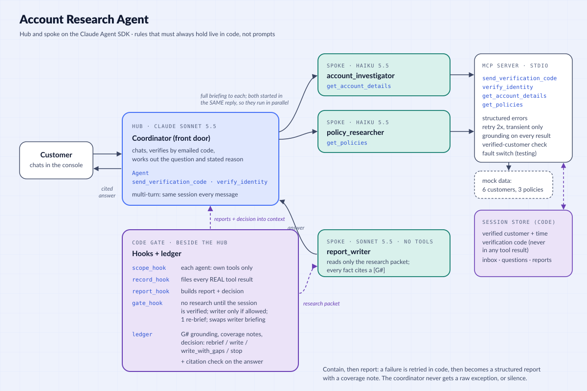

# Account Research Agent

A three-agent research system built as the Stage 3 capstone for the Dev Compass Claude Certified Architect course. A customer asks why their account was flagged. A coordinator verifies who they are, then starts two specialists **in parallel**: one reads the account record, one reads the policy for the reason the customer was given. A third agent writes a plain-language answer where every fact links back to its source. Failures are contained and reported, never hidden, and the answer says what could not be checked instead of guessing.

Built on the **Claude Agent SDK** throughout (subagents, hooks, an MCP server). Everything runs on fake data (`mock_data.py`).


*The demo opens on the architecture, then runs one live conversation with "Show JSON" on. Maya asks for help and is verified by a code sent to the simulated inbox. Then come her question and the parallel start, each tool result as JSON, the reports built by code with grounding IDs, the decision, and the writer's cited answer. The run ends on the citation check and the source behind [G1]. [Full-size screenshot](docs/console.png).*

## Architecture: hub and spoke



```
customer ──> COORDINATOR (hub)  front door: chats, verifies by emailed code, works out the question
               │  tools: Agent + send_verification_code + verify_identity
               ├─ account_investigator   tool: get_account_details   ┐ started in the SAME reply,
               ├─ policy_researcher      tool: get_policies          ┘ so they run in parallel
               └─ report_writer          no tools; reads a research packet built by code
MCP server (stdio): the four tools, the verification code, the verified-customer check, retries, fault switch
Code gate (hooks + ledger), beside the hub:
   scope_hook    each agent may call only its own tools (deny by default)
   record_hook   files every REAL tool result in a ledger
   report_hook   code builds each specialist's report and the decision, and hands them to the coordinator
   gate_hook     no research before verification; writer only when the decision allows; one re-brief;
                 replaces the writer's briefing with the code-built packet
```

Specialists never talk to each other. Each starts blank and sees only its briefing, and the coordinator never touches data directly.

## What it does
| Capability | Where |
|---|---|
| Verification by a 6-digit emailed code; the code lives only in the session, never in a tool result; 3 wrong codes lock | `tools.py`, `session_store.py` |
| Programmatic gate: no research until the session is verified, and the account tool serves only the verified customer | `hooks.py` (`gate_hook`), `tools.py` |
| Parallel specialists started from one coordinator reply (proven by a shared `message_id`) | `agents.py`, `coordinator.py` |
| Structured errors: `errorCategory`, `isRetryable`, `attempted`, `attempts`; "not found" is a valid answer, not an error | `errors.py`, `tools.py` |
| Bounded retry in code for transient errors only (2 retries, exponential backoff) | `errors.py` (`with_retry`) |
| Reports built by code from real tool results: status, findings, error, coverage note | `ledger.py` |
| Grounding: every finding carries its source (record ID, URL, version, dates, read time) and a `G#` ID | `tools.py`, `ledger.py` |
| Decision table in code: `wait` → `rebrief` (once) → `write` / `write_with_gaps` / `stop` | `ledger.py` (`decision`) |
| Report writer with a clean context: its briefing is replaced by a code-built packet (`updatedInput`) | `hooks.py`, `ledger.py` (`writer_packet`) |
| Citation check: every `[G#]` and URL in the final answer must exist in the research | `ledger.py` (`check_citations`) |
| Multi-turn conversation with follow-ups in the same verified session | `coordinator.py` (`Conversation`) |
| Fault injection without code changes (`FAULT_INJECT=account:timeout`) | `tools.py`, `mcp_server.py` |
| Research Console: live chat with a behind-the-scenes stream, a Show JSON switch for every tool result, report, decision and citation check, light and dark | `console.py`, `console.html` |

## Setup
```bash
python3.12 -m venv .venv
.venv/bin/pip install -r requirements.txt
cp .env.example .env.local      # then put your own ANTHROPIC_API_KEY in .env.local
```

## Run it
```bash
.venv/bin/python console.py     # Research Console at http://127.0.0.1:8001
.venv/bin/python main.py        # the same conversation in the terminal
```
Chat as a customer. When support asks for your email, use one of the test customers. The code arrives in the simulated inbox. Then say what reason you were given.

| Test customer | Email | Try |
|---|---|---|
| Maya Patel | `maya.patel@example.com` | Restricted for a payment dispute (the happy path) |
| Daniel Brooks | `daniel.brooks@example.com` | No flag; say you were flagged anyway |
| Priya Raman | `priya.raman@example.com` | Flagged for fraud; say it was a payment dispute |
| Tomas Silva | `tomas.silva@example.com` | Security hold; ask four questions in one message |
| Grace Kim | `grace.kim@example.com` | Flagged for a terms violation, which has no policy on file |
| Leo Novak | `leo.novak@example.com` | Closed account with past flags |

The console's outage switches make the account or policy service time out (or fail once) on the next message.

## Tests
```bash
.venv/bin/python tests/run_all.py     # all offline suites (free, no API calls): 134 checks
.venv/bin/python tests/test_live.py   # live checks through the real front door (about $0.40): 42 checks
```
The offline suites cover tools, verification, errors and retries, the MCP server across processes, scope and gate hooks, the ledger, the decision table, the writer's packet and the citation check. The live checks run the course's required cases end to end:
- both sources succeed (the answer cites the policy URL, the chargeback trigger and each restricted feature with its date)
- the stated reason differs from the real flag
- an active account the customer believes is flagged
- the account service is down (the policy still arrives and the gap is stated)
- both services are down (stop, no writer)
- a four-part question

Every scenario is mapped in [`docs/TEST-SCENARIOS.md`](docs/TEST-SCENARIOS.md).

## Design choices worth knowing
- **Contain, then report.** A specialist never passes a raw exception up and never hides a failure. Transient errors are retried in code; anything still failing becomes a structured report with a coverage note, so the coordinator always knows what happened and what to do next.
- **Facts are attached by code, never copied by a model.** The ledger records real tool results. Reports, grounding IDs, the writer's packet and the final answer are all held by code, so a model cannot drop or alter a URL or a date on the way.
- **Rules that must always hold live in hooks.** "Verify first" is in the prompt, but the gate is what stops research before verification. "Don't write if nothing came back" is in the prompt, but the gate is what blocks the writer.
- **The specialists do not retry.** Retries already happen inside the tool, so the model calls once. Retrying in both layers would multiply attempts and make the record disagree with reality.
- **The customer's stated reason comes from their own words.** The policy lookup uses it, so it can run in parallel with the account lookup. When the two differ, the answer says so.

## Differences from the course reference code
- **Claude Agent SDK instead of hand-written Messages API loops.** The course uses `asyncio.gather()`; here the coordinator starts both subagents in one reply.
- **Structured results are built by code from real tool results.** The course has the model write JSON and parses it with a fallback.
- **A real front door** (emailed code, session gate). The course scenario starts from a known customer ID.
- **The data tools live in one MCP server**, with per-agent scope enforced by a hook.
- **Failure tests use a fault switch** instead of editing the subagent source.
- **Synthesis is a third subagent** fed a code-built packet, plus an automatic citation check.

## Known limits
- Verification is simulated: the "email" is a panel in the console.
- When the customer does not know why they were flagged, the policy lookup has no reason to search for. The answer explains the account and offers to look up the rules for that flag in a follow-up.
- Fake data does not change between lookups.
- One conversation at a time in the console, on your own machine only (no login).
